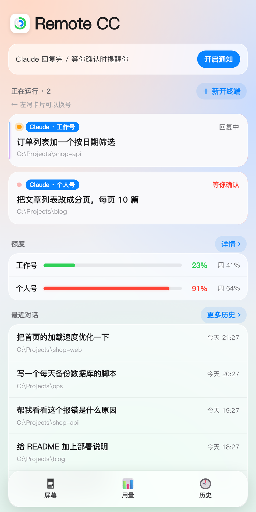
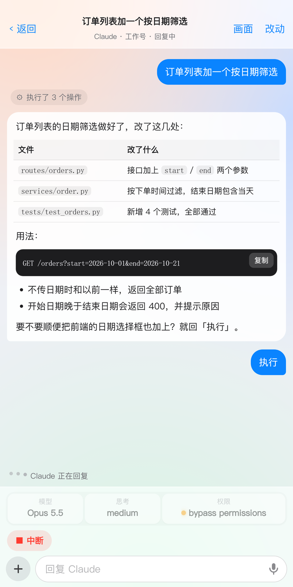
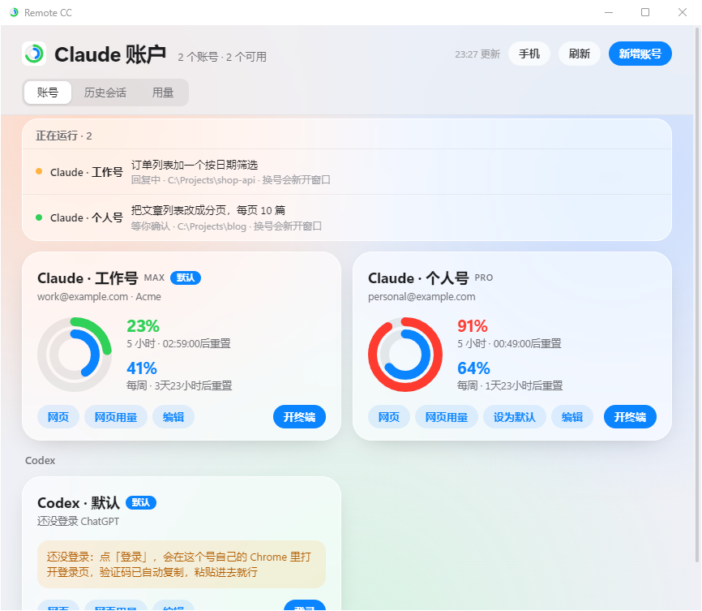

# Remote CC

**用手机远程操控电脑上的 Claude Code。** 看终端、回消息、按住说话、切模型和权限、收推送通知，躺在沙发上也能盯着 Claude 干活。顺带管理多个 Claude Code / Codex 账号。

[English](#english)

> 这是个人开发的第三方工具，**不是 Anthropic 或 OpenAI 的官方项目**，和它们没有任何关系。

<p align="center">
  
  &nbsp;
  
</p>
<p align="center">
  
</p>

---

## 能做什么

### 手机上
- **所有终端一目了然**：哪个在回复、哪个在等你确认，正在回复的卡片带扫光效果
- **像聊天一样回消息**：Claude 的回复按 Markdown 排版（表格、代码块、列表），代码块一键复制
- **终端画面**：直接看电脑终端上显示的内容，用 ↑ ↓ 回车 Esc 数字键操作选择框
- **按住说话**：松手后在电脑上转成文字发给 Claude（可选功能，需要 faster-whisper）
- **发图片**：手机拍照或截图直接发给 Claude 看
- **切换模型 / 思考程度 / 权限模式**：输入框上方一点就切
- **快捷回复**：Claude 让你「回『执行』」「回编号」时，自动变成按钮
- **推送通知**：Claude 回复完、等你确认时提醒你（iPhone 需从主屏幕图标打开）
- **改动对比、任务进度、网页预览**：Claude 改了哪些文件、做到第几步、起的本地网页，手机上都能看
- **历史对话**：全文搜索所有聊天内容，选个账号接着聊
- **Codex 也能管**：桌面版和终端版的 Codex 对话都能看、能回

### 电脑上
- 托盘小窗口，可以开机自启（安装时选）
- **多账号**：每个号独立的登录、独立的 Chrome，开终端时选用哪个号；运行中可以把对话换到另一个号接着聊
- 显示每个号的 5 小时 / 每周用量，用到 90% 提醒

---

## 安装

### 需要
- Windows 10 / 11，装好 [Windows Terminal](https://aka.ms/terminal)
- [Claude Code](https://docs.anthropic.com/claude-code)（原生安装版，能在终端里直接敲 `claude`）
- Python 3.10 以上
- 可选：[Tailscale](https://tailscale.com)（在外面也能用手机连）、Chrome、Codex

### 步骤
1. 点本页右上角绿色的 **Code → Download ZIP**，解压到一个固定的位置（比如 `C:\RemoteCC`，之后别再挪）
2. 双击 **`install.bat`**。它会：
   - 检查 Python、Claude Code、Windows Terminal 装了没有，缺什么告诉你去哪装
   - 安装依赖
   - 配好 Claude Code 的状态栏（Remote CC 读用量、读模型都靠它；改之前会先备份；你已经有自己的状态栏的话会先问你）
   - 在桌面建「Remote CC」快捷方式，问你要不要开机自启、要不要装语音输入
3. 双击桌面上的 **Remote CC**。第一次打开时 Windows 会问「是否允许访问网络」，点**允许**
4. 在小窗口里点「手机」，用手机扫二维码（手机要连着和电脑同一个 Wi-Fi）
5. iPhone 用 Safari 打开后点「分享 → 添加到主屏幕」，以后从主屏幕图标打开

**手机打不开？** 多半是 Windows 防火墙拦了。「手机」弹窗里会显示防火墙状态，没放行的话点「一键放行」，在弹出的授权窗口里点「是」就行。它只放行家里局域网和 Tailscale 的设备，外网连不进来。

### 在外面也能用 / 收推送通知
电脑和手机都装 [Tailscale](https://tailscale.com) 并登录同一个账号，然后在电脑上运行一次：
```
tailscale serve --bg 8765
```
这样二维码会换成加密的 HTTPS 地址，在外面也能连，也能收推送通知（iPhone 必须从主屏幕图标打开才能收通知）。

### 手动安装
不想用 `install.bat` 的话：`pip install -r requirements.txt`，再把 `%USERPROFILE%\.claude\settings.json` 里的 `statusLine` 设成：
```json
"statusLine": {
  "type": "command",
  "command": "powershell -NoProfile -ExecutionPolicy Bypass -File \"C:/你放仓库的路径/statusline.ps1\""
}
```
然后 `pythonw app.py` 启动。

---

## 用量数据从哪来

用量**只读本机上 Claude Code 和 Codex 自己提供的数据**，不调用任何非公开接口：
- Claude：Claude Code 每次刷新状态栏时会把用量交给 `statusline.ps1`，脚本存一份到该账号的配置文件夹里
- Codex：读该账号最近的对话记录里 Codex 记下的用量

所以某个号要开过终端才有数据，开着的时候会实时更新。

---

## 安全提醒

- 手机网页靠一串随机密钥访问（存在 `%USERPROFILE%\.claude-accounts\mobile-key.txt`），**拿到这个地址的人就能操控你电脑上的终端**。不要把地址发给别人。
- 只建议在 Tailscale 或家里局域网内使用，**不要把端口直接暴露到公网**。
- 推荐给 Claude Code 用的权限模式要自己把握：bypass 模式下 Claude 执行命令、改文件都不会再问你。

## 关于多账号

多账号功能用于管理你自己合法持有的多个账号（比如工作号和个人号）。使用时请遵守 Anthropic、OpenAI 的用户条款，账号使用方式带来的后果由使用者自行承担。

---

## English

**Remote CC lets you drive Claude Code on your Windows PC from your phone.** Watch every terminal, reply like a chat, hold-to-talk, switch model / effort / permission mode, get push notifications when Claude finishes or needs you, review file changes, preview local web pages, search and resume past conversations. It also manages multiple Claude Code and Codex accounts.

> Unofficial third-party tool. Not affiliated with Anthropic or OpenAI.

**Requirements:** Windows 10/11 with Windows Terminal, native Claude Code, Python 3.10+. Optional: Tailscale (remote access + HTTPS for push), Chrome, Codex, faster-whisper (voice input).

**Setup:** download the ZIP, unzip it somewhere permanent, double-click `install.bat` (checks prerequisites, installs dependencies, points Claude Code's `statusLine` at `statusline.ps1` with a backup, creates a desktop shortcut). Open **Remote CC** from the desktop, click 「手机」 and scan the QR code with your phone. For remote access and push notifications, install Tailscale on both devices and run `tailscale serve --bg 8765`.

**Usage data** comes only from what Claude Code and Codex themselves report locally (the status line input and Codex session logs). No private APIs are called.

**Security:** anyone with the phone URL (it contains a random key) can control your terminals. Use it over Tailscale or your LAN only; never expose the port to the internet.

**Multiple accounts:** meant for accounts you legitimately own (e.g. work and personal). You are responsible for complying with Anthropic's and OpenAI's terms.

The UI is currently Chinese only.

## License

MIT
